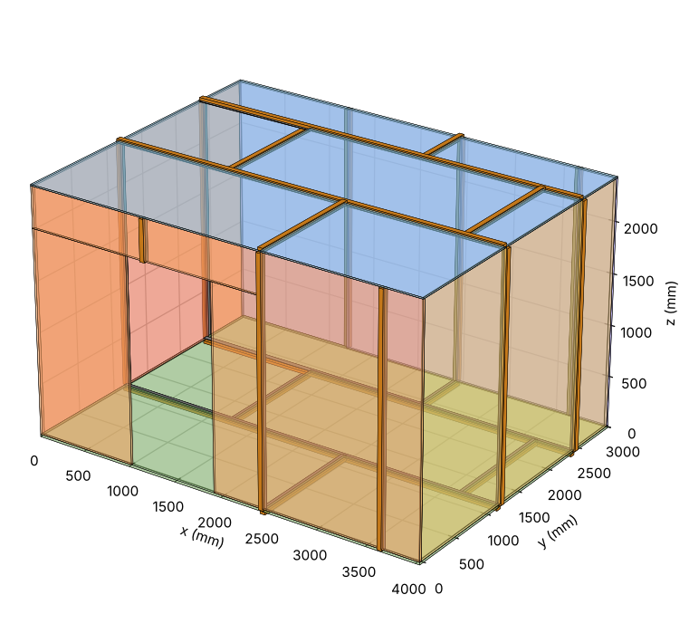

# Anechoic Chamber Panel Planner

A small Python tool that takes the dimensions of an anechoic chamber built from steel-clad hardboard panels joined with hat & flat metalwork, and generates:

- 2D and 3D **CAD drawings** (DXF)
- A full **bill of materials**
- A **panel cut list**, including nesting of the cut pieces onto sheets
- A **hat & flat cut list**, packed onto stock bars

The chamber is a floor, four walls and a ceiling, with an optional door opening. All dimensions are in **millimetres**.



Example output for the sample config is in [`examples/`](examples/).

## Features

- Set the **internal** dimensions (length, width, height); external size follows from the panel thicknesses.
- Panel thickness = board thickness + steel skin on each face. Override the board thickness per surface (e.g. a thinner ceiling).
- Configurable **sheet size** (default 2440 x 1220 mm).
- **Running-bond (staggered) layout**: alternate rows are offset so seams meet in T-junctions rather than four-way crosses. Set `stagger` to `0` for a straight grid.
- **Door opening** on any wall: position, width and height. Panels are cut around it and any infill above or beside the door is generated.
- **Hat & flat** seams generated from the panel layout, with cut lengths, stock-bar packing and a fastener estimate.
- Cut pieces are shelf-packed onto sheets so the BOM reflects the sheets you actually need to buy.

## Requirements

- Python 3.8+
- [`ezdxf`](https://ezdxf.mozman.at/) (DXF output)
- `matplotlib` (optional, only for the PNG preview)

```bash
pip install ezdxf matplotlib
```

## Usage

```bash
# Print an example config
python chamber.py --example > config.json

# Edit config.json, then generate everything into ./out
python chamber.py config.json -o out

# Or try the bundled example straight away
python chamber.py example_config.json -o out
```

## Configuration

```json
{
  "internal": {"length": 4000, "width": 3000, "height": 2400},
  "sheet": {"length": 2440, "width": 1220},
  "board_thickness": 22,
  "steel_thickness": 0.7,
  "thickness_override": {"ceiling": 12},
  "hat_flat": {
    "hat_width": 50, "hat_depth": 25, "flat_width": 50,
    "stock_length": 3000, "end_clearance": 0, "screw_pitch": 150
  },
  "corner_joints": false,
  "stagger": 0.5,
  "kerf": 3,
  "door": {"wall": "south", "offset": 1000, "width": 900, "height": 2000}
}
```

| Key | Meaning |
| --- | --- |
| `internal` | Internal chamber dimensions: `length` (x), `width` (y), `height` (z). |
| `sheet` | Maximum panel (sheet) size. |
| `board_thickness` | Hardboard thickness. |
| `steel_thickness` | Steel plate thickness **per face**. Total panel thickness = board + 2 x steel. The `0.7` in the example is a placeholder; use your real figure. |
| `thickness_override` | Per-surface board thickness. Keys: `floor`, `ceiling`, `north`, `south`, `east`, `west`. |
| `hat_flat.hat_width` / `hat_depth` | Hat section profile width and depth. |
| `hat_flat.flat_width` | Flat section width. |
| `hat_flat.flat_thickness` | Flat section thickness, used in the 3D model only (default 3). |
| `hat_flat.stock_length` | Length of stock bars for hat and flat. |
| `hat_flat.end_clearance` | Length trimmed off each end of every seam piece. |
| `hat_flat.screw_pitch` | Fastener spacing, used for the fastener estimate. |
| `hat_flat.draw_in_3d` | Set `false` to leave hat & flat out of the 3D model (default `true`). |
| `corner_joints` | `true` adds hat & flat along the floor/ceiling edges and the four vertical corners. |
| `stagger` | Row offset as a fraction of sheet length. `0.5` = half-sheet running bond, `0` = straight grid. |
| `kerf` | Saw kerf allowance used when nesting cut pieces and cutting bars. |
| `door.wall` | `north`, `south`, `east` or `west`. Omit `door` for no opening. |
| `door.offset` | Distance along the wall from the internal west face (north/south walls) or internal south face (east/west walls) to the nearest edge of the door. |
| `door.width` / `door.height` | Door opening size. |
| `explode_mm` | Distance each surface is pushed out in the exploded 3D file (default 300). |

## Outputs

| File | Contents |
| --- | --- |
| `chamber.dxf` | 2D drawing: plan view plus a layout of each of the six surfaces, with labelled panels, cut sizes, hat & flat seams and the door opening. |
| `chamber_3d.dxf` | 3D model of the assembled chamber (panels and hat & flat). |
| `chamber_3d_exploded.dxf` | The same model with each surface pushed outward. |
| `chamber_3d.png` | Quick preview render (needs `matplotlib`). |
| `bom.csv` | Sheets (whole and for cut pieces), hat and flat bars, total run, fasteners, thickness per surface. |
| `panel_cutlist.csv` | Every panel with size, full/cut, and for cut pieces which sheet and where on it. |
| `hatflat_cutlist.csv` | Each seam length, which stock bar it is cut from, and the offcut left on each bar. |
| `summary.txt` | External size, door, panel and hat & flat totals. |

## Coordinate system

Plan view: **x** runs west to east along the chamber length, **y** south to north along the width, **z** up. Origin is the internal south-west floor corner.

- Floor and ceiling span the full external footprint.
- North and south walls run the full external length; east and west walls fit between them.
- Wall layout drawings are drawn in plan-axis order (west to east, or south to north), not mirrored per viewing side.

## Assumptions and limitations

- "Hat & flat diameter" is modelled as a profile **width and depth** for the hat and a width for the flat.
- In the 3D model the **hat sits on the outside face** and the **flat on the inside face** of each seam.
- The door is a plain opening: no frame, lintel or threshold, and no hat & flat around its perimeter.
- Corner joints use hat & flat only if `corner_joints` is enabled; real corners may use angle or other trim.
- The offcut nesting is a simple shelf-packing heuristic. It gives a workable sheet count, not a guaranteed optimum.
- With `stagger`, a row can end in a narrow sliver depending on the dimensions. Check the cut list for very small pieces.
- The 3D DXF uses polyface meshes (surfaces), not editable solids.
- The tool plans the panel layout only. It does not check structural adequacy, support spacing or acoustic performance, so verify seam positions against your framing and loads.

## Licence

Add a licence of your choice (for example MIT) before publishing.
