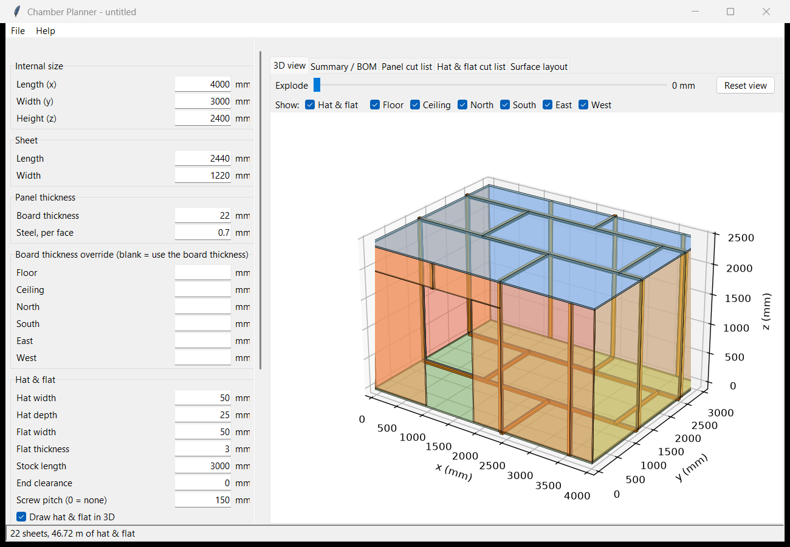
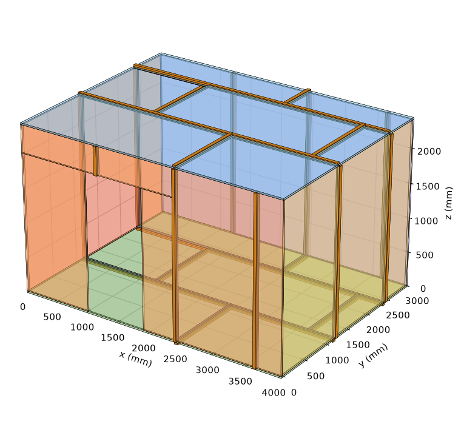

# Anechoic Chamber Panel Planner

A small Python tool that takes the dimensions of an anechoic chamber built from steel-clad hardboard panels joined with hat & flat metalwork, and generates:

- 2D and 3D **CAD drawings** (DXF)
- A full **bill of materials**
- A **panel cut list**, including nesting of the cut pieces onto sheets
- A **hat & flat cut list**, packed onto stock bars

The chamber is a floor, four walls and a ceiling, with an optional door opening. All dimensions are in **millimetres**.

It comes in two forms that share the same code and produce identical files: a **Windows GUI** (`ChamberPlanner.exe`) with a live 3D view, and the original **command-line tool** driven by a JSON config.





Example output for the sample config is in [`examples/`](examples/).

## Features

- Set the **internal** dimensions (length, width, height); external size follows from the panel thicknesses.
- Panel thickness = board thickness + steel skin on each face. Override the board thickness per surface (e.g. a thinner ceiling).
- Configurable **sheet size** (default 2440 x 1220 mm).
- **Running-bond (staggered) layout**: alternate rows are offset so seams meet in T-junctions rather than four-way crosses. Set `stagger` to `0` for a straight grid.
- **Door opening** on any wall: position, width and height. Panels are cut around it and any infill above or beside the door is generated.
- **Hat & flat** seams generated from the panel layout, with cut lengths, stock-bar packing and a fastener estimate.
- Cut pieces are shelf-packed onto sheets so the BOM reflects the sheets you actually need to buy.

## Getting started

### Windows executables (no Python needed)

Download from the [latest release](../../releases/latest):

| File | What it is |
| --- | --- |
| `ChamberPlanner.exe` | The GUI. Double-click to run. |
| `chamber-cli.exe` | The command-line tool, for use in a terminal: `chamber-cli.exe config.json -o out`. |
| `ChamberPlanner-onedir.zip`, `chamber-cli-onedir.zip` | The same programs as an unzipped folder (see the note below). |

> **Windows Defender / SmartScreen warning.** These executables are **not code-signed**, and unsigned
> PyInstaller one-file programs are often flagged by Windows Defender, SmartScreen or other antivirus
> tools (a "Windows protected your PC" screen, or a false-positive detection). The source is all in this
> repository and the executables are built from it by the public GitHub Actions workflow. If your
> machine objects, use the `-onedir.zip` downloads, which are flagged far less often, or run from source.
> Click *More info* then *Run anyway* only if you trust the download.

### From source

Python 3.10 or newer, with [`ezdxf`](https://ezdxf.mozman.at/) (DXF output) and `matplotlib` (3D view and PNG preview). Tkinter ships with the standard Windows and macOS Python installers; on Debian/Ubuntu install `python3-tk`.

```bash
pip install -r requirements.txt

python -m chamber.gui                 # the GUI
python chamber.py config.json -o out  # the command line
```

## The GUI

Run `ChamberPlanner.exe` (or `python -m chamber.gui`; an optional argument opens a config file).

- **Left: the form**, grouped like the JSON: internal size, sheet, board and steel thickness, per-surface board overrides, hat & flat, corner joints, stagger, kerf, explode distance and the door. Every key in the [configuration table](#configuration) has a field.
- **Right: tabs**
  - **3D view**: the assembled chamber, rotatable (drag) and zoomable (right-drag or scroll). The *Explode* slider runs from 0 to `explode_mm`. Untick *Hat & flat* or any surface to look inside; hiding a surface also hides its hat & flat.
  - **Summary / BOM**: external size, panel and hat & flat totals, bill of materials, panel thickness by surface.
  - **Panel cut list** and **Hat & flat cut list**: the same tables as the CSV files.
  - **Surface layout**: a 2D drawing of any one surface, with panel IDs, cut sizes and the door.
- The model recalculates about 300 ms after you stop typing. A problem is shown in red next to the field that caused it (for example *Door does not fit within the wall*) and the last good view stays on screen until it is fixed.
- **File menu**: open, save and save-as for JSON configs; **Export all** writes the same files as the command line into a folder you choose; **Export single item** writes any one of them. Opening a file with missing keys applies the defaults; keys the GUI does not know about are kept when you save.
- Window size and the last folder you used are remembered in `%APPDATA%\ChamberPlanner\settings.json` (never in the repository).

## Command line

```bash
# Print an example config
python chamber.py --example > config.json

# Edit config.json, then generate everything into ./out
python chamber.py config.json -o out

# Or try the bundled example straight away
python chamber.py example_config.json -o out
```

A config that cannot be built (a door that does not fit, a negative size, ...) gives a plain message and exit code 1 rather than a traceback.

## Configuration

```json
{
  "internal": {"length": 4000, "width": 3000, "height": 2400},
  "sheet": {"length": 2440, "width": 1220},
  "board_thickness": 22,
  "steel_thickness": 0.7,
  "thickness_override": {},
  "hat_flat": {
    "hat_width": 50, "hat_depth": 25, "flat_width": 50,
    "stock_length": 3000, "end_clearance": 0, "screw_pitch": 150
  },
  "corner_joints": false,
  "stagger": 0.5,
  "kerf": 3,
  "door": {"wall": "south", "offset": 1000, "width": 900, "height": 2000}
}
```

| Key | Meaning |
| --- | --- |
| `internal` | Internal chamber dimensions: `length` (x), `width` (y), `height` (z). |
| `sheet` | Maximum panel (sheet) size. |
| `board_thickness` | Hardboard thickness. |
| `steel_thickness` | Steel plate thickness **per face**. Total panel thickness = board + 2 x steel. The `0.7` in the example is a placeholder; use your real figure. |
| `thickness_override` | Per-surface board thickness. Keys: `floor`, `ceiling`, `north`, `south`, `east`, `west`. |
| `hat_flat.hat_width` / `hat_depth` | Hat section profile width and depth. |
| `hat_flat.flat_width` | Flat section width. |
| `hat_flat.flat_thickness` | Flat section thickness, used in the 3D model only (default 3). |
| `hat_flat.stock_length` | Length of stock bars for hat and flat. |
| `hat_flat.end_clearance` | Length trimmed off each end of every seam piece. |
| `hat_flat.screw_pitch` | Fastener spacing, used for the fastener estimate. |
| `hat_flat.draw_in_3d` | Set `false` to leave hat & flat out of the 3D model (default `true`). |
| `corner_joints` | `true` adds hat & flat along the floor/ceiling edges and the four vertical corners. |
| `stagger` | Row offset as a fraction of sheet length. `0.5` = half-sheet running bond, `0` = straight grid. |
| `kerf` | Saw kerf allowance used when nesting cut pieces and cutting bars. |
| `min_panel` | Minimum piece size in mm, default `0` (off). When set, the leftover strip at the end of a row, and at the top of a surface, is not allowed to be narrower than this: the joint is moved so the end piece is exactly this size and the neighbouring panel is cut down to suit (e.g. 2440 + 387 becomes 2327 + 500 with `min_panel: 500`). Must be no more than half the shorter sheet side. Pieces still under the minimum because of the door cut-out are reported as warnings. |
| `door.wall` | `north`, `south`, `east` or `west`. Omit `door` for no opening. |
| `door.offset` | Distance along the wall from the internal west face (north/south walls) or internal south face (east/west walls) to the nearest edge of the door. |
| `door.width` / `door.height` | Door opening size. |
| `explode_mm` | Distance each surface is pushed out in the exploded 3D file (default 300). Also the top of the GUI's explode slider. |

Optional keys may be left out and take their defaults: `steel_thickness` 0, `thickness_override` none, `hat_flat.flat_thickness` 3, `hat_flat.end_clearance` 0, `hat_flat.screw_pitch` 0 (no fastener estimate), `hat_flat.draw_in_3d` true, `corner_joints` false, `stagger` 0.5, `kerf` 3, `explode_mm` 300, `door` none.

## Outputs

| File | Contents |
| --- | --- |
| `chamber.dxf` | 2D drawing: plan view plus a layout of each of the six surfaces, with labelled panels, cut sizes, hat & flat seams and the door opening. |
| `chamber_3d.dxf` | 3D model of the assembled chamber (panels and hat & flat). |
| `chamber_3d_exploded.dxf` | The same model with each surface pushed outward. |
| `chamber_3d.png` | Quick preview render (needs `matplotlib`). |
| `bom.csv` | Sheets (whole and for cut pieces), hat and flat bars, total run, fasteners, thickness per surface. |
| `panel_cutlist.csv` | Every panel with size, full/cut, and for cut pieces which sheet and where on it. |
| `hatflat_cutlist.csv` | Each seam length, which stock bar it is cut from, and the offcut left on each bar. |
| `summary.txt` | External size, door, panel and hat & flat totals. |

## Coordinate system

Plan view: **x** runs west to east along the chamber length, **y** south to north along the width, **z** up. Origin is the internal south-west floor corner.

- Floor and ceiling span the full external footprint.
- North and south walls run the full external length; east and west walls fit between them.
- Wall layout drawings are drawn in plan-axis order (west to east, or south to north), not mirrored per viewing side.

## Assumptions and limitations

- "Hat & flat diameter" is modelled as a profile **width and depth** for the hat and a width for the flat.
- In the 3D model the **hat sits on the outside face** and the **flat on the inside face** of each seam.
- The door is a plain opening: no frame, lintel or threshold, and no hat & flat around its perimeter.
- Corner joints use hat & flat only if `corner_joints` is enabled; real corners may use angle or other trim.
- The offcut nesting is a simple shelf-packing heuristic. It gives a workable sheet count, not a guaranteed optimum.
- With `stagger`, a row can end in a narrow sliver depending on the dimensions. Set `min_panel` to have the ends re-cut, or check the cut list for very small pieces.
- `min_panel` only re-cuts row and column ends. A piece made narrow by the door cut-out (the strip above a door, a thin piece beside it, or a row joint landing close to the door head) cannot be fixed that way and is listed as a warning in `summary.txt`, the GUI summary tab and the status bar. Balancing turns one full sheet into a cut piece, so the sheet count can occasionally rise.
- The 3D DXF uses polyface meshes (surfaces), not editable solids.
- The 3D view in the GUI draws one shape per layer for speed, so overlapping translucent faces can sort slightly differently from the PNG preview.
- The tool plans the panel layout only. It does not check structural adequacy, support spacing or acoustic performance, so verify seam positions against your framing and loads.

## Project layout

```
chamber/
  core.py        config defaults and validation, tiling, cut-list packing, 3D solids (no printing, no file I/O)
  exporters.py   CSV and summary files, 2D and 3D DXF, PNG preview, export_all()
  render.py      matplotlib drawing shared by the PNG and the GUI
  cli.py         command line
  gui.py         Tkinter app
chamber.py       thin shim so `python chamber.py config.json -o out` keeps working
packaging/       PyInstaller build script and entry points
tests/           pytest suite
```

## Development

```bash
pip install -r requirements-dev.txt
python -m pytest
```

The tests include a golden check that the CLI output for `example_config.json` is unchanged, geometry invariants (panel areas plus door equal the surface area, no overlaps), config validation, CLI/GUI/export parity, and a GUI smoke test that is skipped when there is no display.

To build the executables on Windows: `python packaging/build_exes.py` (add `--onedir` for folders). They land in `dist/`. The GitHub Actions workflow in `.github/workflows/build.yml` runs the tests on Linux and Windows, builds both executables, checks them (the console exe's output is compared with the golden files; the GUI exe's `--selftest` loads the example and exports everything), uploads them as artefacts, and attaches them to a GitHub Release when a `v*` tag is pushed.

## Licence

Released under the [MIT Licence](LICENSE).
